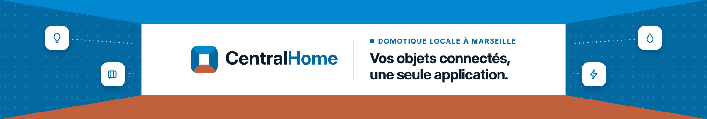
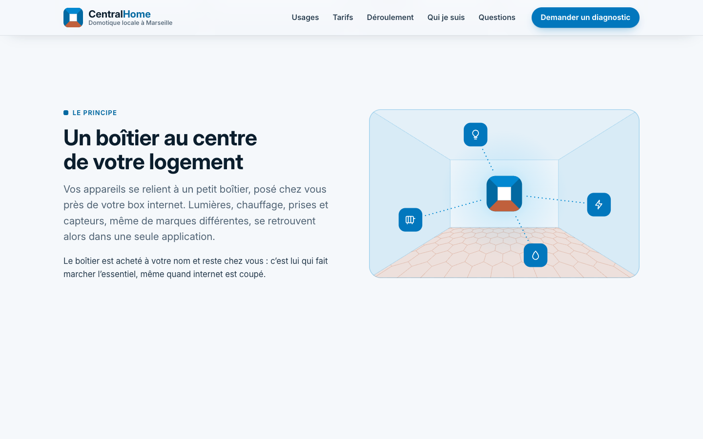
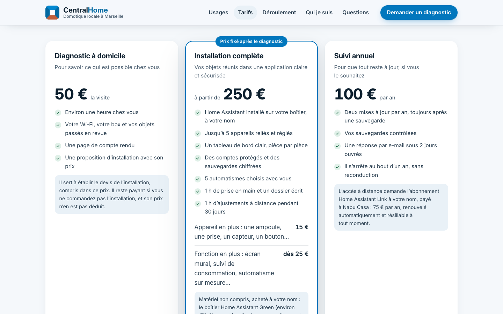
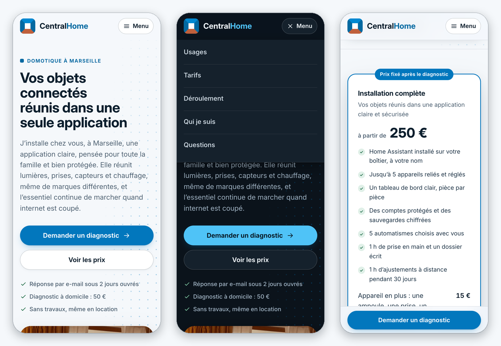
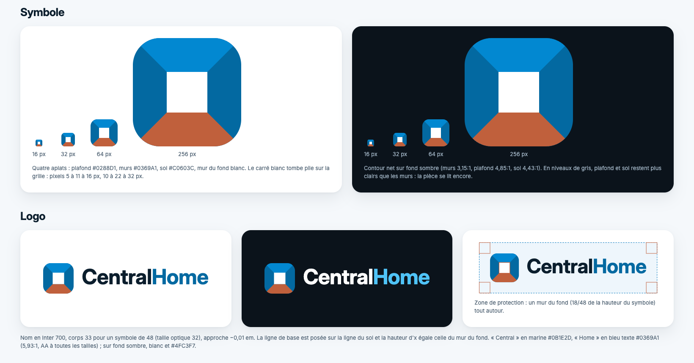
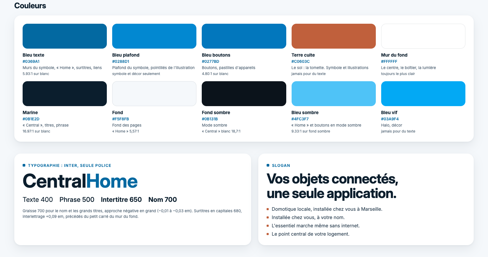
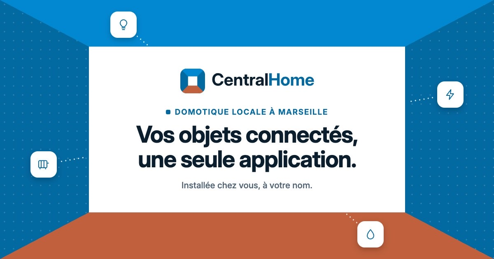
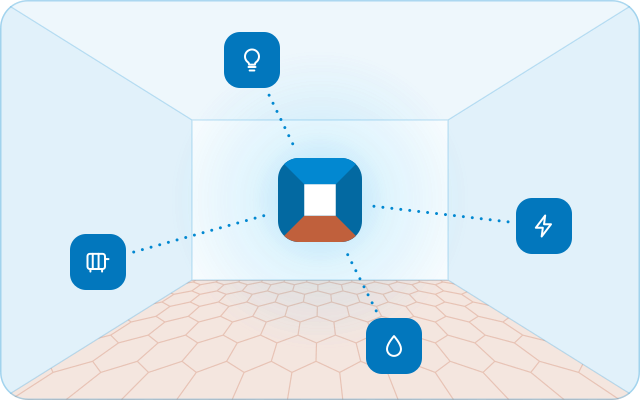
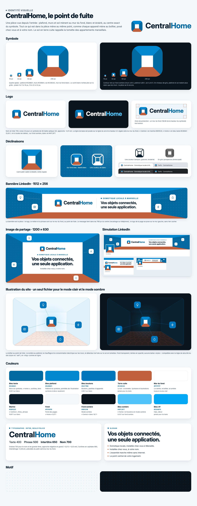

# CentralHome

CentralHome est ma marque de domotique locale à Marseille. J'installe chez des particuliers un boîtier qui réunit leurs objets connectés et les services de la maison dans une seule application, construite sur Home Assistant. L'installation se fait sans travaux, le matériel est au nom du client, et l'essentiel continue de marcher sans internet.

Le site est en ligne sur [antoninche.github.io/centralhome](https://antoninche.github.io/centralhome/). Ce dépôt réunit le site publié et l'identité visuelle de la marque.

## Le site

Onze pages : accueil, usages, tarifs, déroulement, présentation, questions fréquentes, demande de diagnostic, conditions générales de vente, mentions légales, données personnelles et page 404.

- Site statique en HTML, CSS et JavaScript, sans framework ni dépendance, publié par GitHub Pages.
- Thème clair et sombre selon le réglage de l'appareil, mise en page de 320 à 1920 px de large, barre d'action fixe sur mobile.
- Accessibilité visée WCAG 2.2 niveau AA, contrôlée avec axe-core sur chaque page, dans les deux thèmes, sur ordinateur et sur mobile.
- Politique de sécurité du contenu stricte, déclarée dans chaque page : aucun style en ligne, scripts en ligne autorisés par leur empreinte SHA-256.
- Aucun cookie, aucune mesure d'audience, aucune ressource externe : la police Inter et les images sont hébergées avec le site.
- Photos en AVIF et WebP à plusieurs largeurs, en chargement différé sauf la photo d'ouverture.
- Adresse e-mail et numéro de téléphone absents du code HTML, reconstitués à l'affichage, pour limiter la collecte automatique.
- Formulaire de demande sans serveur : il prépare l'e-mail dans la messagerie du visiteur, et l'affiche prêt à copier si aucune messagerie ne s'ouvre.
- Balises Open Graph et données structurées schema.org `LocalBusiness` pour les moteurs de recherche et les réseaux sociaux.

| | |
|---|---|
|  |  |
| L'accueil en thème sombre. | Le principe du boîtier, avec l'illustration de la marque. |
|  |  |
| Les trois formules de la page Tarifs. | Le formulaire de demande de diagnostic. |

## L'identité visuelle

Le symbole est une pièce vue depuis l'entrée : plafond, murs et sol mènent au mur du fond, blanc, au centre exact. Chaque appareil mène au boîtier de la même façon. Le sol en terre cuite rappelle la tomette des appartements marseillais ; c'est la seule couleur chaude d'une palette de bleus. Le nom s'écrit en Inter, graisse 700, « Central » en marine et « Home » en bleu. Le slogan : « Vos objets connectés, une seule application. »

| | |
|---|---|
|  |  |
| L'image affichée quand on partage un lien du site (Open Graph, 1200 × 630). | L'illustration de la page d'accueil : un seul fichier SVG pour les deux thèmes. |

Les logos existent en SVG, avec le nom vectorisé, et en PNG, pour fond clair et pour fond foncé. Les règles d'usage (espace libre, tailles minimales, couleurs, fonds, interdits) sont dans la [charte graphique](marque/charte-graphique.md).

Planche d'identité complète

## Organisation du dépôt

| Dossier | Contenu |
|---|---|
| [docs/](docs/) | Le site, tel qu'il est publié par GitHub Pages |
| [marque/](marque/) | Charte graphique, planche d'identité, logos, déclinaisons du symbole, bannière |
| [images/](images/) | Captures d'écran du site et extraits de la planche |

## Licence

Le code et les contenus de ce dépôt sont distribués sous licence [Apache 2.0](LICENSE). Elle permet de les réutiliser, de les modifier et de les redistribuer, y compris à des fins commerciales, à condition de joindre la licence, de signaler les modifications et de conserver le fichier [NOTICE](NOTICE).

Elle ne donne aucun droit sur le nom CentralHome, son logo ni son symbole : ils restent réservés et ne peuvent pas servir à désigner un autre produit, service ou site. La police Inter est sous licence SIL Open Font License 1.1 ([docs/polices/LICENCE-Inter.txt](docs/polices/LICENCE-Inter.txt)), et les photos restent sous la licence de leurs auteurs (Pexels, Unsplash), indiquée dans les mentions légales du site. Home Assistant est une marque de l'Open Home Foundation ; CentralHome n'y est pas affilié.
