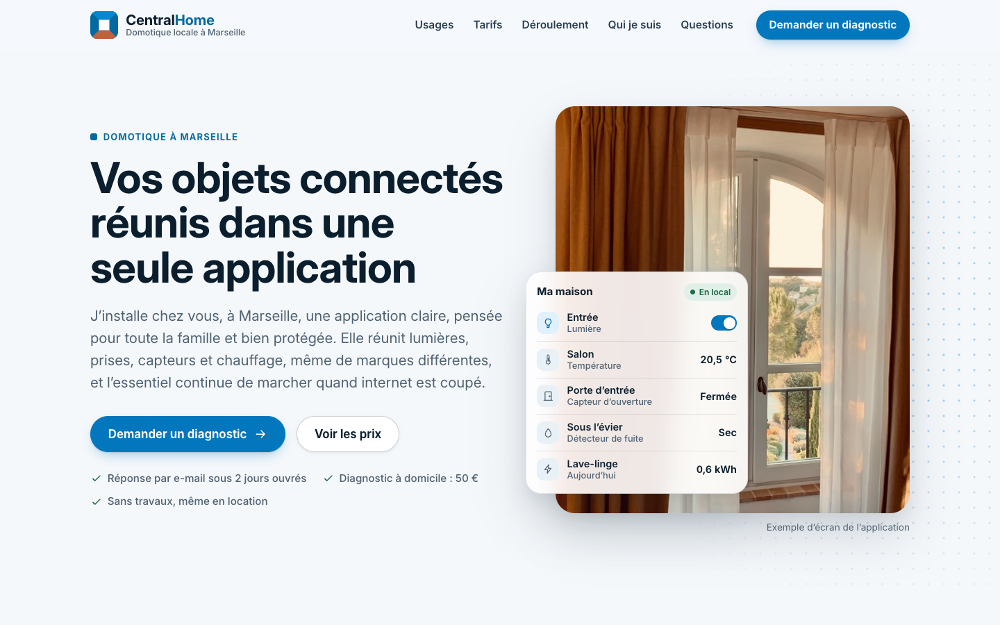
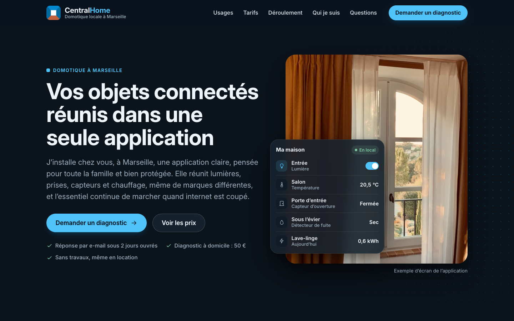
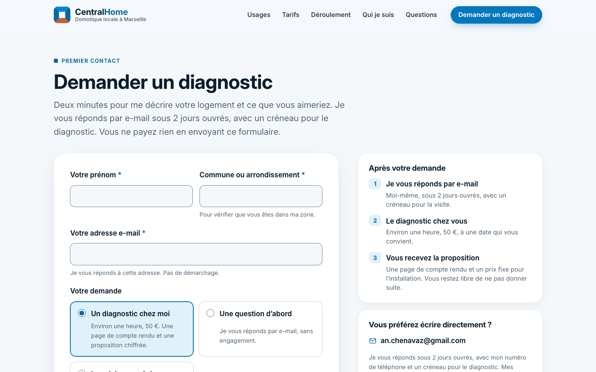
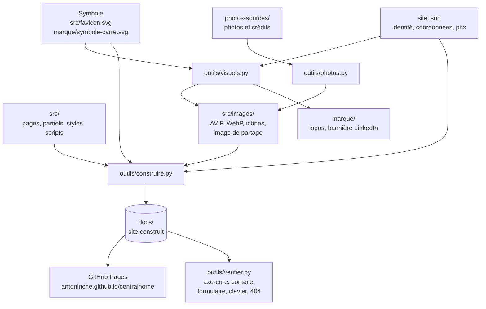

# CentralHome


CentralHome est ma marque de domotique locale à Marseille. J'installe chez des particuliers un boîtier qui réunit leurs objets connectés et les services de la maison dans une seule application, construite sur Home Assistant. L'installation se fait sans travaux, le matériel est au nom du client, et l'essentiel continue de marcher sans internet.

Ce dépôt contient le site de la marque, son identité visuelle et les outils qui les produisent. Le site est publié par GitHub Pages sur [antoninche.github.io/centralhome](https://antoninche.github.io/centralhome/), à partir du dossier [`docs/`](docs/).

## Le site

Onze pages en HTML statique, générées par un script Python sans dépendance à partir de gabarits et d'un fichier de configuration unique, [`site.json`](site.json).

- Accueil, usages, tarifs, déroulement, présentation, questions fréquentes, demande de diagnostic, conditions générales de vente, mentions légales, données personnelles et page 404.
- Thème clair et sombre selon le réglage de l'appareil, mise en page de 320 à 1920 px de large, barre d'action fixe sur mobile.
- Accessibilité visée WCAG 2.2 niveau AA, contrôlée avec axe-core sur chaque page, dans les deux thèmes, sur ordinateur et sur mobile.
- Politique de sécurité du contenu stricte, déclarée dans chaque page, puisque GitHub Pages n'envoie pas d'en-têtes personnalisés : tout est servi par le site lui-même, aucun style en ligne, scripts en ligne autorisés par leur empreinte SHA-256.
- Aucun cookie, aucune mesure d'audience, aucune ressource externe : la police Inter et les images sont hébergées avec le site.
- Photos en AVIF et WebP à plusieurs largeurs (`srcset`), en chargement différé sauf la photo d'ouverture.
- Adresse e-mail et numéro de téléphone retirés du texte et des liens du code HTML, reconstitués à l'affichage, pour limiter la collecte automatique.
- Formulaire de demande sans serveur : il prépare l'e-mail dans la messagerie du visiteur, et l'affiche prêt à copier si aucune messagerie ne s'ouvre.
- Balises Open Graph sur chaque page ; données structurées schema.org `LocalBusiness` et plan du site dans la version publiée. La version de travail n'est pas indexée (`noindex`).
- La construction avec `--publication` échoue tant qu'une information obligatoire manque dans `site.json` (SIREN et sa clé de contrôle, mention « EI », adresse, téléphone, médiateur de la consommation, hébergeur…) ou que les conditions générales de vente manquent.



| | |
|---|---|
|  |  |
| L'accueil en thème sombre. | Le principe du boîtier, avec l'illustration de la marque. |
|  |  |
| Les trois formules de la page Tarifs. | Le formulaire de demande de diagnostic. |


## L'identité visuelle

Le symbole est une pièce vue depuis l'entrée : plafond, murs et sol mènent au mur du fond, blanc, au centre exact. Chaque appareil mène au boîtier de la même façon. Le sol en terre cuite rappelle la tomette des appartements marseillais ; c'est la seule couleur chaude d'une palette de bleus. Le nom s'écrit en Inter, graisse 700, « Central » en marine et « Home » en bleu. Le slogan : « Vos objets connectés, une seule application. »


| | |
|---|---|
|  |  |
| L'image affichée quand on partage un lien du site (Open Graph, 1200 × 630). | L'illustration de la page d'accueil : un seul fichier SVG pour les deux thèmes. |

Les logos existent en SVG, avec le nom vectorisé, et en PNG, pour fond clair et pour fond foncé. Les règles d'usage (espace libre, tailles minimales, fonds, interdits) sont dans la [charte graphique](marque/charte-graphique.md), les textes de présentation et les variantes du slogan dans [textes-centralhome.md](marque/textes-centralhome.md).

<details>
<summary>Planche d'identité complète</summary>


</details>

## Architecture



Le générateur insère les partiels, remplace les valeurs de `site.json`, protège les coordonnées, déclare dans chaque page sa politique de sécurité avec l'empreinte de ses scripts en ligne, puis vérifie chaque lien interne et chaque ancre. Il travaille dans un dossier temporaire et ne remplace `docs/` que si la construction réussit. Les outils de visuels et de vérification pilotent Google Chrome avec Playwright ; la construction du site n'en a pas besoin. Détails dans [documentation/generateur.md](documentation/generateur.md).

## Démarrage

Python 3.9 ou plus récent suffit pour construire le site :

```sh
python3 outils/construire.py
python3 -m http.server 8000 --directory docs
```

Le site est alors servi sur http://localhost:8000. Sans option, c'est la version de travail : elle n'est pas indexée par les moteurs de recherche, et les informations légales absentes de `site.json` y sont surlignées en hachuré. `--publication` produit la version mise en ligne.

| Outil | Rôle | Prérequis |
|---|---|---|
| `outils/construire.py` | Construction du site dans `docs/` | Python 3.9 ou plus récent |
| `outils/photos.py` | Photos en AVIF et WebP | `sips` (macOS), `cwebp`, `avifenc` |
| `outils/visuels.py` | Logos, icônes, image de partage, bannière LinkedIn | Playwright, Google Chrome, fontTools, brotli, uharfbuzz, `sips` (macOS) |
| `outils/verifier.py` | Accessibilité, console, formulaire, clavier et page 404, sur le site servi comme par GitHub Pages | Playwright, Google Chrome, axe-core |

## Déploiement

GitHub Pages publie le dossier `docs/` de la branche `main`. Après une modification, reconstruire la version publiée, puis faire un commit et un push : le site est à jour en une à deux minutes.

```sh
python3 outils/construire.py --publication
```

Le site est servi sous le chemin `/centralhome/`. Ses liens sont relatifs, sauf ceux de la page 404, écrits depuis ce chemin pour fonctionner à n'importe quelle profondeur. Le fichier `docs/.nojekyll` fait publier les fichiers tels quels, sans passage par Jekyll. Détails dans [documentation/deploiement.md](documentation/deploiement.md).

## Organisation du dépôt

| Dossier ou fichier | Contenu |
|---|---|
| [site.json](site.json) | Nom commercial, identité légale, coordonnées, médiateur, hébergeur, prix |
| [src/pages/](src/pages/) | Le texte de chaque page |
| [src/partiels/](src/partiels/) | Tête du document (meta, Open Graph), en-tête, pied de page, appel final, barre d'action mobile, icônes et logo, texte du paiement |
| [src/css/](src/css/), [src/js/](src/js/) | Feuille de styles ; scripts du site et du formulaire |
| [src/images/](src/images/), [src/polices/](src/polices/) | Images, illustration et icônes ; police Inter et sa licence |
| [docs/](docs/) | Le site construit, publié par GitHub Pages ; refait à chaque construction |
| [marque/](marque/) | Identité visuelle : charte, planche, logos, symbole, bannière LinkedIn, textes de présentation |
| [photos-sources/](photos-sources/) | Photos d'origine et leurs crédits |
| [outils/](outils/) | Générateur, traitement des photos, visuels, vérifications |
| [documentation/](documentation/) | Configuration, générateur, visuels, vérifications et déploiement |

## Licence

Le code, les textes et l'identité visuelle de CentralHome appartiennent à Antonin Chenavaz, tous droits réservés. La police Inter est distribuée sous licence SIL Open Font License 1.1 ([src/polices/LICENCE-Inter.txt](src/polices/LICENCE-Inter.txt)). Les photos restent sous la licence de leurs auteurs (Pexels, Unsplash), indiquée dans [photos-sources/photos.json](photos-sources/photos.json) et reprise dans les mentions légales du site. Home Assistant est une marque de l'Open Home Foundation ; CentralHome n'y est pas affilié.
